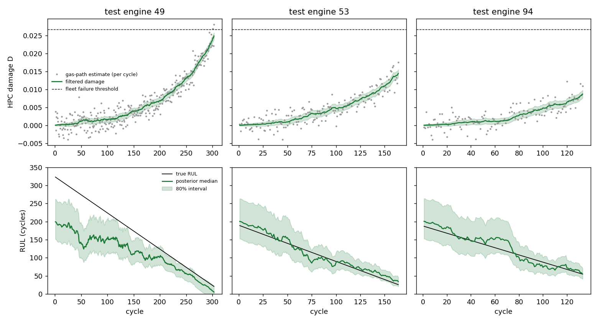
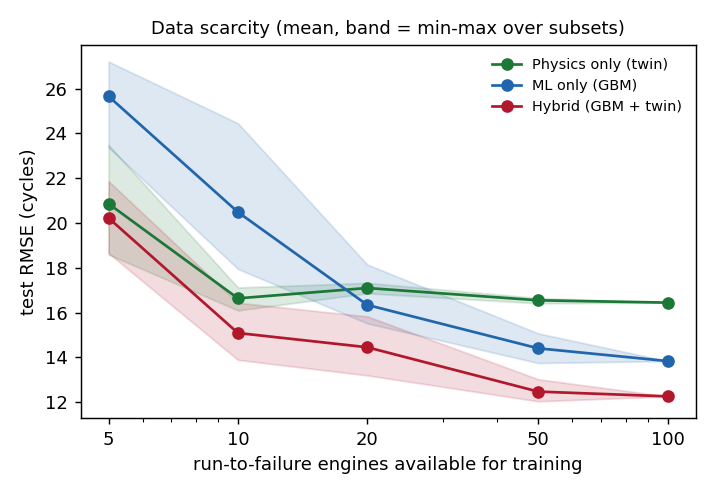
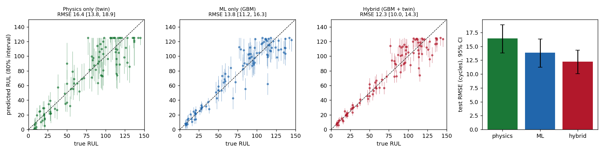
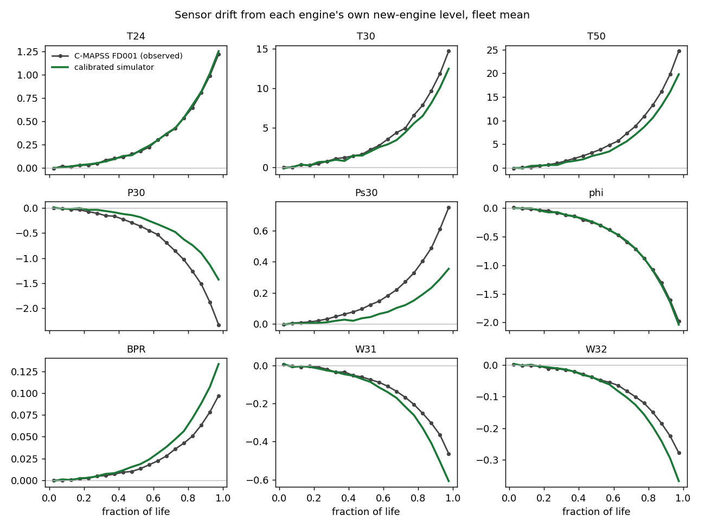
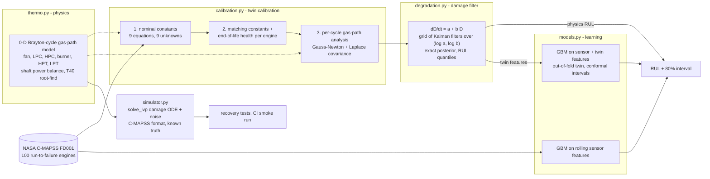

# Hybrid digital twin for turbofan degradation

[](https://github.com/Praruj/turbofan-digital-twin/actions/workflows/ci.yml)

[](LICENSE)

A physics-based model of a two-spool turbofan, calibrated to NASA's C-MAPSS run-to-failure fleet, used
three ways: on its own as a **digital twin** that tracks compressor damage and predicts remaining useful
life (RUL) with uncertainty, as a **simulator** that generates realistic run-to-failure data with known
ground truth, and as a source of **physics-informed features** for a machine-learning model.

Everything runs on a laptop CPU with free tools (numpy, scipy, scikit-learn). No paid API, no GPU.
Every number below comes from `python -m turbotwin.pipeline --config configs/fd001.yaml`
(about 30 minutes) and is written to [`results/fd001/results.json`](results/fd001/results.json).

| On the 100 official held-out test engines (FD001) | RMSE, cycles (95% CI) | 80% interval coverage |
|---|---|---|
| Physics only: calibrated twin, no learned regressor | 16.4 [13.8, 18.9] | 74% |
| ML only: gradient-boosted trees on sensor features | 13.8 [11.2, 16.3] | 80% |
| **Hybrid: the same trees + twin features** | **12.3 [10.0, 14.3]** | 65% (too narrow, see finding 4) |

With **5 training engines** instead of 100, the twin and the hybrid reach RMSE 20.9 and 20.2, against 25.7
for ML only (means over 5 random subsets).



## What I found

**1. Nine sensors, one fault.** After calibration, the model explains each engine's start-to-end sensor
drift with two physical health parameters: HPC efficiency loss and HPC flow-capacity loss. Their
end-of-life estimates are almost perfectly correlated across the 100 training engines (r = 0.98), so
FD001's fault is effectively one-dimensional. That is why a single damage variable *D* can carry the twin.
At failure, the fleet has lost about 1.5% HPC efficiency and 2.2% flow capacity
(D = 0.027 ± 0.004 along the fault direction).

**2. The physics gets the direction right, but not every detail of the size.** The model predicts the
sign of drift correctly for all 9 sensors. Magnitudes are within about 15% for T24, T30, T50 and the fuel
ratio phi. It underestimates the P30 drop (−1.5 vs −2.3 psia) and the Ps30 rise (+0.39 vs +0.74). It
overestimates the bypass-ratio and bleed-flow changes. On engines it never saw, the physics subspace
explains 48% of the per-cycle sensor variance, against 56% for a purely data-driven PCA with the same
two degrees of freedom. The difference is model-form error, and I report it rather than tune it away
(see *Limitations*).

**3. Physics alone is the best choice with very little run-to-failure data, and the hybrid is best everywhere.**

| Training engines | Physics only | ML only | Hybrid |
|---|---|---|---|
| 5 | 20.9 (18.6–23.5) | 25.7 (23.4–27.2) | 20.2 (18.7–21.9) |
| 10 | 16.6 (16.1–17.1) | 20.5 (18.0–24.5) | 15.1 (13.9–16.4) |
| 20 | 17.1 (16.9–17.3) | 16.3 (15.5–18.1) | 14.5 (13.2–15.8) |
| 50 | 16.6 (16.4–16.7) | 14.4 (13.8–15.1) | 12.5 (12.0–13.0) |
| 100 | 16.4 | 13.8 | 12.3 |

*Test RMSE on the same 100 held-out engines. Mean (min–max) over 5 random training subsets; one run at
100 engines.*

The twin needs only about 10 failures to calibrate, and after that it stops improving: its error is set by
model form, not by data. ML only catches up with the twin at about 20 engines. Adding the twin's posterior
to the trees helps at every training size. On the full training set, the hybrid-minus-ML difference is
−1.6 RMSE, with a paired-bootstrap 95% CI of [−3.9, +0.9]. With 100 engines the gain is suggestive, not
significant. The hybrid-minus-physics difference is −4.2 [−5.8, −2.6].



**4. The twin's uncertainty is close to honest; the hybrid's is not yet.** The twin's 80% posterior
intervals cover the true RUL for 74% of test engines, and 76% on simulated engines where the model is
exactly right. So the damage filter is close to calibrated, and the remaining shortfall is model-form
error.

For the learned models, intervals are split-conformal, from engine-grouped out-of-fold residuals, with
separate quantiles per band of predicted RUL (Mondrian conformal). ML only reaches the nominal 80%. The
hybrid has the best point accuracy, but its intervals cover only 65% (66% with a single global
quantile). Its out-of-fold residuals are optimistic: a training row's twin features come from a twin
that excluded that engine, but the trees used to score the row were fitted on other rows, whose twins
*did* see it. Proper nested cross-validation should fix this; it is the next thing to do. Until then,
use the twin's interval with the hybrid's point estimate.



**5. The simulator reproduces the fleet.** 500 engines simulated from the calibrated twin live
206 ± 40 cycles, against 206 ± 46 for the 100 real training engines (two-sample KS test p = 0.58). The
fleet-mean drift curves overlay the real ones (figure below). Parameter recovery also works: I simulated
100 engines with known damage and re-calibrated a fresh twin on them blind. It recovered the
compressor-matching constants to within 0.002, the fault direction to within 0.002, and the failure
threshold (0.028 vs 0.027). It tracked damage with an RMSE of 2% of failure damage.



## How it works



**Physics model** ([`thermo.py`](src/turbotwin/thermo.py)). This is a steady-state, lumped-parameter
Brayton-cycle model, solved once per flight cycle at sea-level static conditions:
- Compressors use isentropic efficiencies and pressure ratios.
- The burner uses an energy balance (fuel-air ratio from the lower heating value).
- The HPT supplies the HPC's work; the LPT drives the fan and booster.
- The engine controller holds fan speed. A degraded HPC therefore forces a higher turbine inlet
  temperature T40, found with a vectorised bisection on the LPT power balance.

Health is described by four loss parameters: HPC and fan efficiency loss, and HPC and fan flow-capacity
loss. The model outputs the nine C-MAPSS gas-path sensors (T24, T30, T50, P30, Ps30, phi, BPR, W31, W32)
plus T40, which is not measured. It is fully vectorised, so 600 health hypotheses cost one call.

**Calibration** ([`calibration.py`](src/turbotwin/calibration.py), [`twin.py`](src/turbotwin/twin.py)).
1. Nine design-point constants (booster and HPC pressure ratios, HPC efficiency, nozzle back-pressure,
   sensor gains) are fitted so that a new engine reproduces the fleet's first-30-cycle sensor means. This
   is an exact solve: 9 equations, 9 unknowns.
2. Three compressor-matching constants are fitted jointly with every training engine's end-of-life HPC
   health, from the start-to-end drift. Least squares, noise-normalised.
3. Per cycle, the two HPC health parameters are estimated by Gauss-Newton, with the Laplace covariance as
   uncertainty. This is classical gas-path analysis. Each engine's own first 20 cycles set its baseline,
   which absorbs manufacturing variation.

**Damage filter** ([`degradation.py`](src/turbotwin/degradation.py)). Damage follows self-accelerating
wear, dD/dt = a + bD. This is the ODE form of the exponential damage law used to generate C-MAPSS.
- The wear parameters (a, b) of each engine are unknown. A fleet prior over them comes from per-engine
  fits on the training set.
- Given (a, b), damage is linear-Gaussian. So on a 25×25 grid of (log a, log b), each grid point runs an
  exact Kalman filter, and its marginal likelihood re-weights the grid. This Rao-Blackwellised grid filter
  gives an exact, deterministic posterior with no particle degeneracy.
- RUL is the time for D to reach the fleet's failure threshold. It is integrated over the (a, b) posterior
  and the threshold's spread.
- Process and model-error noise levels are chosen by maximum marginal likelihood over the training fleet.

**Simulator** ([`simulator.py`](src/turbotwin/simulator.py)). It draws (a, b), a failure threshold and a
manufacturing offset per engine, then integrates the damage ODE with `scipy.integrate.solve_ivp` plus a
random-walk term. The damage goes through the cycle model and then through sensor noise with the
estimated variances. Wear, noise and fleet size are all controllable, and the output uses the same
columns as the real data.

**ML and hybrid** ([`features.py`](src/turbotwin/features.py), [`models.py`](src/turbotwin/models.py)).
- Features: for each of 14 informative sensors, the 10-cycle rolling mean, and the 30-cycle slope and
  scatter. The target is RUL capped at 125 (the usual piecewise-linear target); all predictions,
  including the physics ones, are capped the same way.
- Model: scikit-learn `HistGradientBoostingRegressor`.
- The hybrid adds 7 twin features: damage mean and sd, posterior wear parameters, and the physics RUL
  quantiles.

**Leakage control.**
- All features are causal, and a unit test checks that truncating a series doesn't change earlier rows.
- Training rows get twin features from a twin calibrated on the other 4 folds (engine-grouped), so no
  engine's own failure is in the prior or threshold used to featurise it.
- The official test engines are used only for the final evaluation. The physics validation also uses
  their sensor data, but never their RUL labels.
- CIs are engine-level bootstrap (2,000 resamples), and differences between methods are paired.

## Run it

```bash
python -m venv .venv && .venv/Scripts/activate   # or source .venv/bin/activate
pip install -e ".[dev,app]"
pytest                                            # 21 tests, ~15 s
python -m turbotwin.pipeline --config configs/smoke.yaml   # simulated fleet, ~1 min, used by CI
python -m turbotwin.pipeline --config configs/fd001.yaml   # downloads C-MAPSS (12 MB, SHA-256 checked), ~30 min
python -m turbotwin.report results/fd001                   # regenerates results/fd001/tables.md
streamlit run app/streamlit_app.py                         # interactive demo
```

The demo has three tabs:
- **Physics simulator**: sliders for each damage type, showing every sensor's response and the inferred T40.
- **Twin on a real test engine**: pick an engine and replay it cycle by cycle to watch the damage
  posterior and RUL interval update.
- **Simulated fleet**: generate run-to-failure data with adjustable wear rate and sensor noise.

```
src/turbotwin/
  thermo.py        gas-path cycle model (vectorised)
  calibration.py   noise model, nominal + matching calibration, per-cycle gas-path analysis
  degradation.py   wear law, fleet prior, Kalman-bank filter, RUL posterior
  twin.py          DigitalTwin: fit / observe / track / save / load
  simulator.py     run-to-failure fleet simulator
  features.py      causal rolling + twin features
  models.py        physics / ML / hybrid, out-of-fold twin features, Mondrian conformal
  metrics.py       RMSE, MAE, PHM08 score, bootstrap and paired CIs
  pipeline.py      config-driven stages: calibrate, validate, benchmark, scarcity, figures
  plots.py, report.py
configs/           fd001.yaml (full), smoke.yaml (CI)
results/fd001/     results.json, tables.md, test_predictions.csv, twin.json, figures/
```

CI (GitHub Actions) runs ruff, mypy (strict on untyped defs), the test suite and the smoke pipeline on a
simulated fleet, so it needs no download.

## Limitations

- **C-MAPSS is itself simulated.** It was generated by NASA's C-MAPSS engine model, so "real data" here
  means "data from a much more detailed model than mine". This project shows the method. It is not
  evidence about a physical engine. Real fleets add sensor faults, maintenance events and changing
  operating conditions.
- **One operating condition, one fault.** FD001 is sea-level only, with HPC degradation. The cycle model
  already has fan health parameters and ambient inputs, but I have not calibrated it on the
  multi-condition (FD002/FD004) or two-fault (FD003) subsets.
- **Model-form error.** The 0-D model has no component maps. Compressor matching is three fitted
  constants, and the HPC-exit Mach number went to its bound (0.95). C-MAPSS's Ps30 (about 47 psia, beside
  a P30 of 554 psia) cannot be a physical static pressure at HPC exit, so its measurement model is a
  calibrated gain. These choices are why the physics subspace explains less held-out variance than PCA
  (48% vs 56%), and why the physics-only RMSE stops improving at about 16.5.
- **Initial wear vs manufacturing variation.** Each engine's first 20 cycles define its baseline, so
  initial wear is treated as zero.
- **The cap matters.** All methods predict at most 125 cycles. Test engines with true RUL above 125 add
  error to every method alike. Against capped truth, RMSEs are 15.7 / 12.5 / 11.2 (physics / ML / hybrid).
- **Scarcity runs below 10 engines** use in-sample twin features, because 5-fold out-of-fold needs at
  least 10 engines.
- **Recovery checks share the model.** Parameter recovery and the 76% simulated coverage test the
  estimators when the model is exactly right, so they cannot reveal model-form error. The real-data
  numbers above do that.

## Data and references

- Dataset: A. Saxena and K. Goebel (2008), *Turbofan Engine Degradation Simulation Data Set*, NASA Ames
  Prognostics Data Repository. Downloaded from the NASA PCoE mirror (`phm-datasets.s3.amazonaws.com`). It
  is U.S. Government work, publicly released. Raw files are not committed; the pipeline downloads them.
- A. Saxena, K. Goebel, D. Simon, N. Eklund, "Damage propagation modeling for aircraft engine run-to-failure
  simulation", PHM 2008.
- Gas-path analysis background: A. J. Volponi, "Gas turbine engine health management: past, present, and
  future trends", *J. Eng. Gas Turbines Power* 136(5), 2014.
- Conformal prediction: V. Vovk, A. Gammerman, G. Shafer, *Algorithmic Learning in a Random World*, 2005.

MIT licence. Code by Praruj Thapa.
